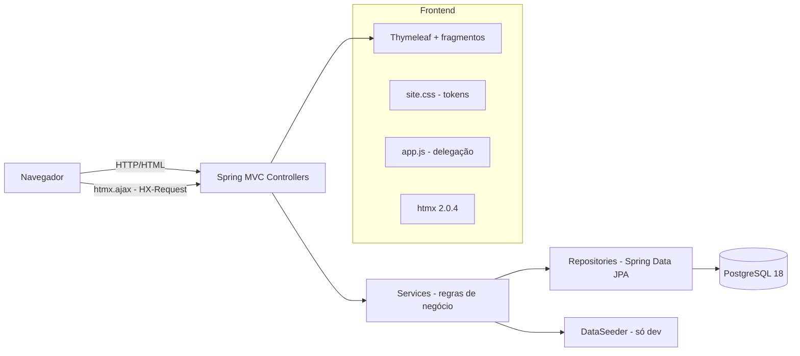
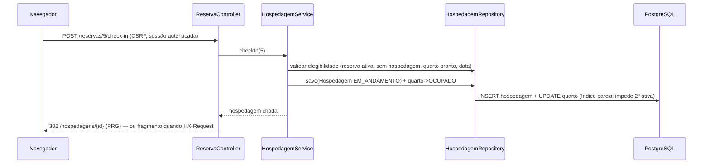
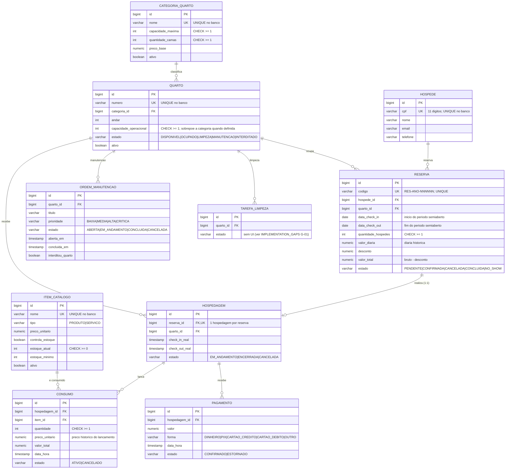
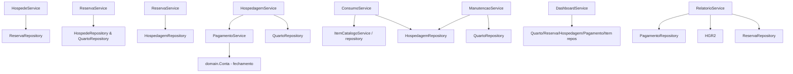

# HotelImpact — Arquitetura técnica

> Documento gerado por leitura sistemática do código em out/2025. Descreve a
> implementação **real** encontrada no repositório — não a arquitetura ideal.
> Quando um ponto não pôde ser confirmado, está marcado explicitamente.

## 1. Visão geral

O HotelImpact é um PMS (Property Management System) de hotelaria: um sistema
administrativo web que gerencia reservas, hospedagens, consumos, pagamentos,
quartos e manutenção. É uma aplicação **monolítica em camadas** com renderização
no servidor (Spring MVC + Thymeleaf), enriquecida com navegação parcial via
htmx (experiência SPA na área autenticada) e um site institucional público.



## 2. Inventário tecnológico

Fontes: `pom.xml`, arquivos de configuração, código-fonte e workflows.

| Tecnologia/dependência | Versão | Finalidade | Onde é utilizada |
|---|---|---|---|
| Java (JDK) | 21 (`<java.version>`) | Linguagem/plataforma | Todo o backend |
| Spring Boot (parent) | 4.2.0-M2 (milestone) | Fundação da aplicação | `pom.xml` — atenção: versão de pré-lançamento |
| spring-boot-starter-webmvc | 4.2.0-M2 | Spring MVC, Tomcat embutido | Controllers, Thymeleaf, static resources |
| spring-boot-starter-thymeleaf | 4.2.0-M2 | Renderização server-side | Todos os templates (`src/main/resources/templates`) |
| spring-boot-starter-validation | 4.2.0-M2 | Bean Validation (Jakarta) | DTOs de formulário (`dto/*Form.java`), `@Valid` nos controllers |
| spring-boot-starter-data-jpa | 4.2.0-M2 | Persistência (Hibernate) | Entities, repositories |
| spring-boot-starter-security | 4.2.0-M2 | Autenticação/autorização, CSRF | `config/SecurityConfig.java`, todos os POSTs |
| PostgreSQL Driver | 42.7.x (gerenciado pelo Boot) | Conexão JDBC | `spring.datasource.*` |
| Flyway + flyway-database-postgresql | gerenciado pelo Boot | Migrations de esquema | `db/migration/V1__esquema_base.sql`; módulo Boot dedicado (`spring-boot-flyway`) |
| Lombok | gerenciado pelo Boot | Boilerplate (`@Getter/@Setter/@RequiredArgsConstructor`) | Entities, forms, services |
| Bootstrap | 5.x (vendorizado) | Grid, utilitários, componentes | `static/vendor/bootstrap/` em todos os templates |
| Bootstrap Icons | 1.x (vendorizado) | Iconografia | `static/vendor/bootstrap-icons/` |
| htmx | 2.0.4 (vendorizado, 50KB) | Navegação parcial SPA | `static/vendor/htmx/htmx.min.js`, `controller/Pagina.java`, `config/HxUrlInterceptor.java` |
| Inter (variable font) | v20 (vendorizada, OFL) | Tipografia única da aplicação | `static/vendor/inter/`, `static/css/inter.css` |
| CSS próprio (site.css) | — | Design system (tokens, shell, componentes) | `static/css/site.css` (~900 linhas) |
| JavaScript próprio (app.js) | — | Tema, confirmações, navegação SPA, sidebar | `static/js/app.js` |
| Maven + Wrapper (`./mvnw`) | Maven 3.9.x (wrapper) | Build e testes | `mvnw`, `pom.xml` |
| JUnit 5 / AssertJ / Mockito | gerenciados pelo Boot | Testes unitários, slice e integração | `src/test/java` (200 testes) |
| spring-boot-starter-webmvc-test / security-test etc. | 4.2.0-M2 | `@WebMvcTest`, `SecurityMockMvc` | `web/*Test.java` |
| Testcontainers (PostgreSQL) | definido em `testcontainers.version` | Banco real efêmero nos testes | `integration/*Test.java`, `support/AbstractIntegrationTest` |
| Docker / Docker Compose | compose v2 | Banco local de desenvolvimento | `docker-compose.yml` (postgres:18, porta 5433) |
| GitHub Actions (CI) | workflow `ci.yml` | Suíte completa a cada push/PR em `main` | `.github/workflows/ci.yml` (Temurin 21, `./mvnw test`) |
| spring-boot-devtools | runtime (scope `runtime`?) | Reinício em desenvolvimento | `pom.xml` — **uso real não confirmado em produção**; aceitável como ferramenta de dev |

Observações verificáveis: o perfil `prod` desliga seed e cache de template;
o `application.properties` define `ddl-auto=update` (dev) e o `prod` usa
`validate`; a fonte Inter e o htmx são **vendorizados** (sem CDN em runtime).

## 3. Estrutura do projeto

```text
hotelimpact/
├── pom.xml / mvnw                     # build (Maven wrapper)
├── docker-compose.yml                 # PostgreSQL 18 local (porta 5433)
├── .github/workflows/ci.yml           # CI: suíte completa a cada push
├── db/init/                           # scripts de inicialização do container
├── docs/                              # esta documentação
└── src/main/
    ├── java/com/gabrielflorencco/hotelimpact/
    │   ├── HotelimpactApplication.java    # main; fuso fixo America/Sao_Paulo
    │   ├── config/      # SecurityConfig, WebConfig, HxUrlInterceptor,
    │   │                # HxRedirectEntryPoint, DataSeeder (APP_SEED_DEMO),
    │   │                # ConstraintsBancoRunner
    │   ├── controller/ # 11 controllers MVC + Pagina (decisão htmx)
    │   ├── domain/     # abstrações puras de negócio: Lancamento,
    │   │               # Fechamento (genérico) e Conta (record imutável)
    │   ├── dto/         # forms de entrada (@Valid) e *View de saída
    │   ├── entity/      # 10 entidades JPA
    │   ├── enums/       # 11 enumerações de estado/tipo
    │   ├── exception/   # NegocioException, RegistroNaoEncontradoException,
    │   │                # GlobalExceptionHandler (centralizado)
    │   ├── repository/  # 10 repositórios Spring Data (+consultas JPQL/nativas)
    │   ├── service/     # 11 services (regras de negócio transacionais)
    │   └── validation/  # @Cpf + CpfValidator (algoritmo oficial)
    └── resources/
        ├── application.properties / application-prod.properties
        ├── db/migration/V1__esquema_base.sql   # baseline do esquema (Flyway)
        ├── static/       # css/ (site.css, inter.css), js/app.js,
        │                 # vendor/ (bootstrap, icons, htmx, inter),
        │                 # img/, images/ (logo)
        └── templates/    # layout/fragments, dashboard/, reservas/, hospedagens/,
                          # quartos/, categorias/, hospedes/, itens/, manutencoes/,
                          # relatorios/, site/ (landing), login.html, error/
└── src/test/java/.../
    ├── dto/             # validação de formulários (unitário)
    ├── validation/      # CpfValidatorTest
    ├── service/         # DashboardServiceTest, RelatorioServiceTest
    ├── integration/     # Testcontainers: migração, CRUDs, regras, seed
    ├── web/             # @WebMvcTest por tela + segurança/SPA/site
    └── support/         # AbstractIntegrationTest (container base)
```

### 3.1 Percurso de uma requisição (exemplo: check-in)



Fluxo alternativo: com header `HX-Request: true`, `Pagina.renderizar()`
devolve apenas o fragmento `conteudo` e `HxUrlInterceptor` adiciona
`HX-Push-Url` — o htmx troca o `innerHTML` de `#app-conteudo` sem recarregar.

## 4. Arquitetura em camadas e padrões

| Padrão | Problema que resolve aqui | Participantes | Observações |
|---|---|---|---|
| **Camadas (Layered)** | Separação apresentação/domínio/persistência | `controller → service → repository → entity` | Dependências sempre para dentro; controllers nunca tocam repositories uns dos outros (exceção: `ReservaController` injeta `HospedeRepository`/`QuartoRepository` apenas para popular selects — ver GAPS) |
| **MVC (Spring MVC)** | Roteamento HTTP → view | `@Controller`, Thymeleaf, `Model` | Sem REST/JSON para a UI; respostas HTML/redirect |
| **Repository** | Acesso a dados declarativo | `repository/*Repository.java` | Derivados + `@Query` JPQL/nativa (ex.: `buscarPorTermo`, `findConflitantes`, `somarPorEstadoEntre`) |
| **Service Layer** | Regras de negócio transacionais | `service/*Service.java` (11) | `@Transactional` por método; exceções de domínio |
| **Domínio rico (máquinas de estado)** | Entidades controlam as próprias transições e invariantes | Métodos de negócio nas entidades (`Reserva.confirmar/cancelar/registrarNoShow/concluir`, `Quarto.ocupar/enviarParaLimpeza/concluirLimpeza/interditar/liberarInterdicao/iniciarManutencao/disponibilizar`, `Hospedagem.abrir/encerrar`, `OrdemManutencao.iniciarExecucao/concluirOrdem/cancelarOrdem`, `Consumo.cancelar`, `Pagamento.estornar`) | Services orquestram verificações externas e chamam as operações; **nenhuma transição via setter resta nos services** (apenas inicializações de registros novos) |
| **Interface de domínio + polimorfismo** | Contrato com regras distintas por tipo real | `domain/Lancamento` (impl: `Consumo` conta se ATIVO; `Pagamento` conta se CONFIRMADO); cálculo genérico `domain/Fechamento.totalElegivel(List<T>)`; `EstadoQuarto.exigirRecepcao(Quarto)` por constante | Despacho dinâmico no fechamento da conta e no check-in, sem switch e sem downcasting |
| **DI / IoC** | Acoplamento | Construtores via Lombok `@RequiredArgsConstructor` | Sem field injection |
| **DTO / ViewModel** | Fronteira segura e views dedicadas | `dto/*Form.java` (entrada, validada), `dto/*View.java` (projeções de leitura **final**, campos `final` imutáveis) | Não há mapeador genérico; conversores estáticos (`View.de(entity)`) |
| **Tratamento centralizado de exceções** | Erros consistentes por página | `GlobalExceptionHandler` (`@ControllerAdvice`): `RegistroNãoEncontrado→404`, `NegocioException→mensagem flash 200/30x`, tipo inválido, genérico | Cada handler devolve a view de erro/mensagem adequada |
| **Validação declarativa** | Entradas seguras | `@Valid` + Bean Validation nos forms; `@Cpf` custom | `bindingResult` re-renderiza o formulário com erros inline |
| **Transações declarativas** | Integridade multi-entidade | `@Transactional` nos services | Ex.: check-out conclui reserva + muda quarto na mesma transação |
| **PRG (Redirect After POST)** | Evitar reenvio | Controllers fazem `redirect:` após POST válido | Compatível com htmx (segue o redirect e troca o fragmento) |
| **Fragmentos Thymeleaf** | Composição de UI | `layout/fragments.html` (sidebar, topbar, mensagens, badges, paginação, page-header), `site/fragments.html` | Páginas definem `th:fragment="conteudo"` para o modo SPA |
| **Progressive Enhancement / SPA parcial** | Navegação sem recarregar | `app.js` (delegação total) + `Pagina.renderizar` + `HxUrlInterceptor` + `HxRedirectEntryPoint` | Sem JS: links/forms funcionam; com JS: htmx troca o conteúdo |
| **Seed idempotente** | Demonstração reproduzível | `DataSeeder` (`@ConditionalOnProperty(app.seed-demo)`, blocos por tabela vazia) | Nunca ativo em `prod` (perfil força `false`) |
| **Tokens de design (CSS custom properties)** | Tema claro/escuro + superfícies fixas | `site.css`: `--hi-*` de tema + `--hi-nav-*`/`--hi-sidebar-*` fixos | Navbar pública e sidebar sempre escuras; conteúdo segue `data-bs-theme` |

Técnicas que **não** são padrões formais, mas convenções do projeto:
exclusão lógica por bloqueio (hóspede/item com histórico não são apagados —
a operação é negada), estados de enum persistidos como `varchar` com CHECK
no banco, e densidade de dados com `font-variant-numeric: tabular-nums`.

## 5. Modelo de dados (implementado)

Diagrama ER real (todas as FKs e chaves abaixo estão na `V1__esquema_base.sql`):



### 5.1 Constraints e índices relevantes (V1)

- `ex_reserva_quarto_periodo` — **EXCLUDE USING gist**: impede duas reservas
  **ativas** (`PENDENTE`/`CONFIRMADA`) sobrepostas no mesmo quarto
  (daterange semiaberto `[check-in, check-out)`). É a garantia de
  disponibilidade no nível do banco, não apenas da aplicação.
- `uk_hospedagem_quarto_em_andamento` — índice **único parcial**
  (`WHERE estado = 'EM_ANDAMENTO'`): no máximo **uma** hospedagem ativa
  por quarto, garantido pelo banco.
- `hospedagem_reserva_id_key UNIQUE` — uma hospedagem por reserva (1:1).
- CHECKs de domínio: estados de reserva/hospedagem/consumo/pagamento/
  manutenção/quarto/tarefa, formas de pagamento, `quantidade_hospedes >= 1`,
  `consumo_quantidade >= 1`, `capacidade_maxima >= 1`, `capacidade_operacional >= 1`,
  `estoque_atual >= 0`.
- Unicidades de negócio: `hospede.cpf`, `quarto.numero`, `categoria.nome`,
  `item_catalogo.nome`, `reserva.codigo`.
- 15 índices de consulta (estado, quarto, período, `pagamento(estado, data_hora)` etc.).

### 5.2 Estratégias notáveis

- **Exclusões**: sem `ON DELETE CASCADE` relevante para o histórico —
  regras na aplicação **negam** exclusões com dependências (hóspede com
  reservas, item com consumos, categoria com quartos); exclusões físicas só
  ocorrem quando não há histórico.
- **Carregamento**: `@ManyToOne` padrão (LAZY em coleções); consultas de
  tela usam `JOIN FETCH` explícito (`findByIdComDetalhes`,
  `buscarAtivasPorDataCheckInComDetalhes`) para evitar N+1.
- **Dinheiro**: `BigDecimal` com `precision 10-12, scale 2`; totais calculados
  no servidor (`valorTotal = valorBruto − desconto`,
  `valorBruto = diária × noites`); **não há** campo "pago" na reserva — o saldo
  é derivado de consumos/pagamentos no momento da leitura.
- **Preço histórico**: `Consumo.precoUnitario` congela o preço do catálogo no
  lançamento; mudanças posteriores no catálogo não alteram lançamentos.
- **Timestamps**: `dataHora`/`abertaEm`/`checkInReal` etc. são atribuídos
  **explicitamente** nos services (`LocalDateTime.now()`) — `@CreationTimestamp`
  permanece apenas em campos de auditoria invisíveis (ex.: `Reserva.dataCriacao`).
- **Migrations**: Flyway com `baseline-on-migrate=true` (`baseline-version=1`);
  `V1` é a fotografia do esquema (originada de `pg_dump`), sem `OWNER TO`;
  `V2` adiciona o índice parcial único de tarefa de limpeza aberta por quarto
  (`uk_tarefa_limpeza_aberta`, o mesmo padrão da hospedagem ativa);
  `V3` cria a tabela `registro_auditoria` (CHECK de operação, índices por
  data e por entidade afetada). Bancos já populados recebem baseline na V1
  e aplicam V2/V3 normalmente.
- **Seed**: `DataSeeder` com `APP_SEED_DEMO` (default `false`; `prod` força
  `false`), idempotente por blocos de tabela vazia; massa relativa à data
  corrente (histórico, dia atual e agenda futura).

## 6. Segurança e configuração

| Comportamento | Implementação |
|---|---|
| Autenticação | Form login Spring Security (`/login`), usuário único via env `HOTELIMPACT_USER`/`HOTELIMPACT_PASSWORD` com role `RECEPCAO` (`application.properties`) |
| Autorização | `SecurityConfig`: `/`, `/sobre`, `/funcionalidades`, `/login`, recursos estáticos (`/css/*`, `/js/*`, `/vendor/**`, `/img/*`, `/images/*`) públicos; **todo o resto** exige autenticação. Sem RBAC multiusuário |
| Sessão expirada | `HxRedirectEntryPoint`: pedido htmx sem sessão responde `HX-Redirect: /login` (o htmx redireciona o documento); sem htmx, redirect padrão |
| CSRF | Habilitado (padrão do Boot); token injetado nos forms Thymeleaf via `th:action`; formulários SPA enviam o `_csrf` do próprio form via `FormData` |
| Injeção | JPQL/derived queries parametrizadas; sem concatenação de SQL dinâmico |
| Segredos | Exclusivamente por variáveis de ambiente (datasource, usuário/senha, `PORT`); nenhum segredo no repositório; `.env` fora do versionamento |
| Perfis | default (dev) e `prod` (`ddl-auto=validate`, sem seed, cache de template) |
| Seed isolado | `@ConditionalOnProperty(app.seed-demo=true)`; `application-prod.properties` fixa `app.seed-demo=false` |

Não implementado (ver `IMPLEMENTATION_GAPS.md`): gestão de usuários no banco,
hash de senha próprio (usa o mecanismo padrão do Boot para o usuário único),
rate limiting, headers de segurança customizados além dos padrões do Boot.

## 7. Interface e navegação

- **Shell autenticado**: sidebar escura fixa (grupos expansíveis com estado
  persistido em `localStorage`, recolhível no desktop 64px, offcanvas no
  mobile), topbar com indicador SPA e data, conteúdo `#app-conteudo`.
- **SPA (htmx)**: `app.js` intercepta links internos, filtros GET e POSTs
  operacionais → `htmx.ajax` troca `innerHTML` de `#app-conteudo`; o servidor
  responde apenas `th:fragment="conteudo"` quando `HX-Request: true`
  (`Pagina.renderizar`), com `HX-Push-Url` (`HxUrlInterceptor`) preservando
  URL/histórico; logout navega integralmente (segurança).
- **Sidebar ativa**: `atualizarSidebarAtiva()` deriva o item ativo da URL
  (maior prefixo por segmento) a cada troca — a marcação server-side só
  vale para o carregamento completo.
- **Tema**: `data-bs-theme` em `<html>`, aplicado antes da primeira pintura
  por script inline no head; persistência `localStorage('hi-tema')`;
  fallback `prefers-color-scheme`; botão de alternância na landing e na
  topbar do app (`#botaoTema`, com `aria-pressed`/`aria-label` sincronizados).
- **Superfícies fixas escuras**: tokens `--hi-nav-*`/`--hi-sidebar-*` — navbar
  pública e sidebar escuras em ambos os temas; conteúdo segue o tema global.
- **Design system**: `site.css` (~900 linhas): tokens de cor/typografia/
  espaçamento, `page-header` com breadcrumb e ícone-quadro, `tabela-operacional`,
  badges ponto+rótulo (cor nunca é único sinal), paginação em janela ±2,
  estados vazios, alertas acessíveis (`role=alert/status`).
- **Formulários**: validação server-side com re-render inline
  (`BindingResult`), campos com `@DateTimeFormat(iso=DATE)`, confirmação JS
  para ações destrutivas (`form[data-confirmar]`), CSRF automático.
- **Privacidade na apresentação**: listagens de hóspedes exibem o CPF
  mascarado (`•••.•••.•••-725`) por `HospedeResumoView.mascararCpf` — regra
  de view, coberta por `ViewsEContratosTest`.
- **Landing pública**: hero claro (texto + fotografia licenciada), cards,
  seções editoriais, login split; navbar escura com símbolo da marca + nome.

### 7.1 Fluxo exemplo: pesquisar hóspedes

1. `GET /hospedes?termo=Ana` → `HospedeController.listar`
2. `HospedeService.buscar(termo, pageable)` → `HospedeRepository` JPQL:
   `nome/telefone/email LIKE` + CPF por dígitos, com `Pageable`
3. Controller devolve `hospedes/lista` (ou `:: conteudo` com `HX-Request`)
4. O template renderiza a tabela paginada; com htmx, apenas `#app-conteudo`
   troca e `HX-Push-Url` registra `?termo=Ana` no histórico.

## 8. Dependências entre módulos e fluxos de negócio



Fluxos ponta a ponta implementados (detalhe regra a regra em `BUSINESS_RULES.md`):

- **Reserva**: criar (disponibilidade via service + EXCLUDE do banco) →
  confirmar/cancelar/no-show → check-in (cria hospedagem) → consumos →
  pagamentos → check-out (valida saldo, conclui reserva, quarto→LIMPEZA) →
  concluir limpeza (quarto→DISPONIVEL).
- **Manutenção**: abrir (bloqueia com hospedagem ativa ou ordem ativa;
  CRÍTICA interdita) → iniciar (quarto→MANUTENCAO) → concluir/cancelar
  (restaura **apenas** o estado causado pela própria ordem).
- **Indicadores**: contagens por estado do quarto (ativos), chegadas/saídas
  de hoje (reservas ativas por data), receita do dia (pagamentos CONFIRMADO
  do dia), alerta de estoque (itens `controla_estoque` com `estoque <= mínimo`).
- **Relatórios**: por período [início 00:00, fim+1 00:00): receita confirmada,
  check-ins/check-outs reais, reservas criadas/canceladas/no-show no período,
  hospedagens iniciadas (lista).

## 9. Testes e qualidade

- **244 testes** em quatro níveis:
  - unitários puros: validação de forms (`HospedeFormValidacaoTest`,
    `ReservaFormValidacaoTest`), `CpfValidatorTest`, `ViewsEContratosTest`,
    e domínio puro (`TransicoesDeEstadoTest`, `TransicoesDeEstadoIITest`,
    `EstadoQuartoRecepcaoTest`, `ContaTest` — máquinas de estado e conta);
  - slice `@WebMvcTest`: uma classe por tela + `SecurityWebTest`, `SpaWebTest`
    (fragmento/`HX-Push-Url`/`HX-Redirect`), `SiteWebTest`;
  - integração Testcontainers (PostgreSQL 18 efêmero): um pacote por domínio
    (`ReservasIntegracaoTest`, `HospedagensIntegracaoTest`, `PagamentosIntegracaoTest`,
    `ConsumosIntegracaoTest`, `ManutencoesIntegracaoTest`, `ItensIntegracaoTest`,
    `CadastroIntegracaoTest`, `FundacoesIntegracaoTest`, `DashboardIntegracaoTest`),
    além de `MigracaoFlywayTest` (3 fases de migração), `DataSeederTest`
    (idempotência/integridade/cenários), `LimpezaIntegracaoTest`,
    `ReservaEdicaoIntegracaoTest`, `CategoriaAtivacaoIntegracaoTest` e
    `AuditoriaIntegracaoTest` — o container de integração compartilhado
    garante o seed (ordem-independente) e `FundacoesIntegracaoTest` tem
    container próprio;
  - contexto: `HotelimpactApplicationTests`.
- CI: GitHub Actions roda `./mvnw --batch-mode test` a cada push/PR em `main`
  (o Docker do runner é usado pelo Testcontainers).
- Convenções: fixtures via builder/methods estáticos, asserções AssertJ,
  mocks Mockito (`@MockitoBean` nos slices), container compartilhado por
  suíte (`AbstractIntegrationTest`).

## 10. Execução local

```bash
docker compose up -d          # PostgreSQL 18 na porta 5433
APP_SEED_DEMO=true ./mvnw spring-boot:run   # com dados de demonstração
# /            site público
# /login       recepcao (HOTELIMPACT_USER/PASSWORD via env)
# /painel      área autenticada
```

Perfil de produção: `SPRING_PROFILES_ACTIVE=prod` + `HOTELIMPACT_PASSWORD`
forte + datasource real. Não há ainda pipeline de deploy (decisão em aberto).
