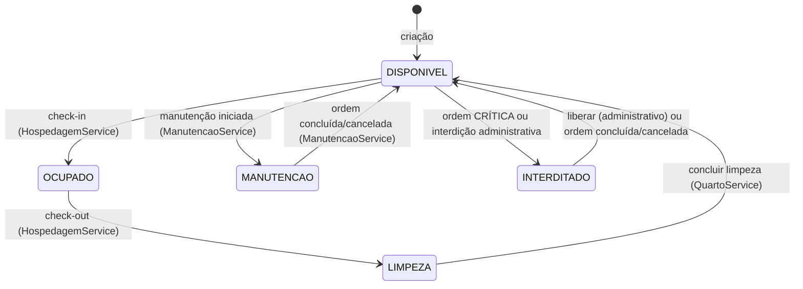
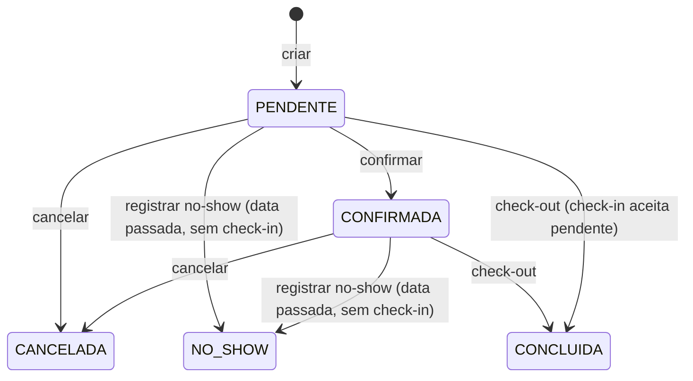
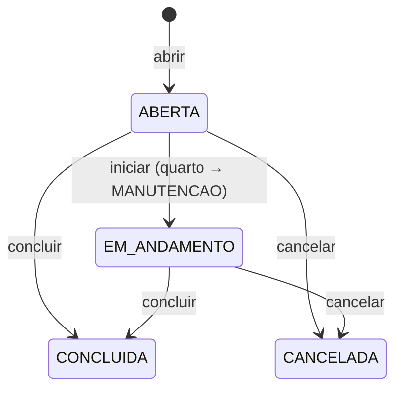

# HotelImpact — Regras de negócio (rastreáveis à implementação)

> Levantamento por leitura sistemática de services, entidades, DTOs,
> constraints (`V1__esquema_base.sql`) e testes (out/2025). Toda regra é
> rastreável: cite o ID (ex.: `BR-RES-004`) ao estudar ou apresentar.
> Status: **implementada** (código + teste/constraint), **parcialmente
> implementada**, **implícita** (garantida só por um mecanismo) ou
> **não implementada**.

Formato por regra: Descrição · Condição de aplicação · Pré-condições ·
Comportamento · Pós-condições · Exceções · Persistência · Implementação ·
Evidências · Status.

---

## 1. Hóspedes (`BR-HOS`)

### BR-HOS-001 — Cadastro e edição com validação declarativa
- **Domínio:** Hóspedes.
- **Descrição:** o hóspede é cadastrado/editado por formulário validado no servidor.
- **Condição:** qualquer criação ou edição via `/hospedes` (POST).
- **Pré-condições:** nenhum.
- **Comportamento:** `HospedeService.salvar` persiste nome (obrigatório, 3–120), CPF (opcional, algoritmo oficial de dígitos verificadores + máscara aceita), e-mail (opcional, formato), telefone (opcional, padrão BR `(11) 98888-0001`), data de nascimento (opcional, `@PastOrPresent`), observações (≤500).
- **Pós-condições:** hóspede persistido; formulário re-renderiza com erros inline quando inválido.
- **Exceções:** violação de Bean Validation → re-render com erros por campo; nenhum dado é salvo parcialmente.
- **Persistência:** `hospede` (nome, cpf, email, telefone, data_nascimento, observacoes, data_cadastro com `@CreationTimestamp`).
- **Implementação:** `dto/HospedeForm.java`, `validation/Cpf.java`+`CpfValidator.java`, `service/HospedeService.java:40`, `controller/HospedeController.java`.
- **Evidências:** `HospedeFormValidacaoTest` (9 testes), `CpfValidatorTest`; constraint `hospede_cpf_key`.
- **Status:** implementada.

### BR-HOS-002 — CPF normalizado e único
- **Descrição:** o CPF é reduzido aos 11 dígitos antes de gravar e buscar; não pode existir dois hóspedes com o mesmo CPF.
- **Comportamento:** `apenasDigitos()` remove formatação; duplicidade verificada no service (`existsByCpf(AndIdNot)`); o banco garante com UNIQUE.
- **Exceções:** duplicado → `NegocioException("Já existe um hóspede cadastrado com este CPF.")`.
- **Implementação:** `HospedeService.java:75-84` (validarCpfUnico/apenasDigitos).
- **Evidências:** constraint `hospede_cpf_key UNIQUE (cpf)`; `CadastroIntegracaoTest`.
- **Status:** implementada (validação no service + UNIQUE no banco).

### BR-HOS-003 — Exclusão preserva o histórico
- **Descrição:** hóspede com qualquer reserva vinculada não pode ser excluído.
- **Motivação (deduzida do código/comentários):** reservas, hospedagens e pagamentos referenciam o hóspede; excluir quebraria o histórico da operação.
- **Comportamento:** `excluir` nega quando `reservas.existsByHospedeId(id)`.
- **Exceções:** com reservas → `NegocioException` com instrução ao operador; sem reservas → exclusão física.
- **Implementação:** `HospedeService.java:62-68`.
- **Evidências:** mensagem no código; testes de cadastro (o bloqueio é diretamente legível).
- **Status:** implementada.

### BR-HOS-004 — Busca por termo único
- **Descrição:** um único termo pesquisa nome, telefone, e-mail (LIKE, case-insensitive) e CPF (termo reduzido a dígitos).
- **Comportamento:** JPQL com `LOWER(...) LIKE` nos três campos + CPF exato por dígitos; resultado paginado.
- **Implementação:** `repository/HospedeRepository.java` (`@Query buscarPorTermo`), `HospedeService.buscar`, `HospedeController.listar` (`?termo=`).
- **Evidências:** consulta no repositório; fluxo validado no navegador (busca "Ana" → 2 resultados, "Limpar" → lista completa).
- **Apresentação (regra de view):** o resultado em listagem exibe o CPF **mascarado** por privacidade (`HospedeResumoView.mascararCpf` — `•••.•••.•••-725`), coberto por `ViewsEContratosTest`.
- **Status:** implementada.

---

## 2. Categorias de quarto (`BR-CAT`)

### BR-CAT-001 — Nome único e atributos válidos
- **Descrição:** categoria tem nome único, capacidade ≥ 1, camas ≥ 1 e preço-base ≥ 0,01.
- **Validações:** Bean Validation no form + CHECKs no banco (`capacidade_maxima >= 1`, `quantidade_camas >= 1`); duplicidade por `existsByNome` e UNIQUE.
- **Implementação:** `CategoriaQuartoService.salvar:38`, `dto/CategoriaForm.java`.
- **Evidências:** `categoria_quarto_nome_key UNIQUE`; `CadastroIntegracaoTest`; CHECKs da V1.
- **Status:** implementada.

### BR-CAT-002 — Exclusão bloqueada com quartos vinculados
- **Descrição:** categoria em uso por quartos não pode ser excluída; a mensagem orienta desativar — **porém não existe operação de desativação de categoria no service** (ver `IMPLEMENTATION_GAPS.md`).
- **Comportamento:** `excluir` conta quartos vinculados e nega se > 0.
- **Implementação:** `CategoriaQuartoService.excluir:58-67`.
- **Evidências:** mensagem de exceção com contagem formatada.
- **Status:** parcialmente implementada (o bloqueio existe; a desativação sugerida não).

---

## 3. Quartos (`BR-QRT`)

### BR-QRT-001 — Número único e categoria ativa
- **Descrição:** cada quarto tem número único e pertence a uma categoria ativa.
- **Validações:** `validarNumeroUnico` (criação e edição) + `exigirCategoriaAtiva`.
- **Persistência:** `quarto.numero` UNIQUE; FK `categoria_id` com índice.
- **Implementação:** `QuartoService.java:143-160`.
- **Evidências:** `quarto_numero_key` no banco; `FundacoesIntegracaoTest`.
- **Status:** implementada.

### BR-QRT-002 — Capacidade efetiva
- **Fórmula:** `capacidadeEfetiva = quarto.capacidadeOperacional ?? categoria.capacidadeMaxima`.
- **Descrição:** a capacidade pode ser sobreposta por quarto (≥1, CHECK); usada na reserva e no check-in.
- **Implementação:** `entity/Quarto.java` (`getCapacidadeEfetiva`), `ReservaService.validarCapacidade:171`.
- **Evidências:** teste `capacidadeEfetivaDaCategoriaOuDoQuartoEBedidaNaCriacao` (ReservasIntegracaoTest); CHECK `capacidade_operacional >= 1`.
- **Status:** implementada.

### BR-QRT-003 — Máquina de estados do quarto
- **Estados:** `DISPONIVEL`, `OCUPADO`, `LIMPEZA`, `MANUTENCAO`, `INTERDITADO` (CHECK no banco).
- **Transições válidas (todas via service, nunca por edição direta):**

- **Transições proibidas:** liberar fora de INTERDITADO e concluir limpeza fora de LIMPEZA são negadas com `NegocioException`.
- **Implementação:** máquina de estados na entidade (`Quarto.ocupar/enviarParaLimpeza/concluirLimpeza/interditar/liberarInterdicao/iniciarManutencao/disponibilizar`, `entity/Quarto.java`), orquestrada por `QuartoService`/`HospedagemService`/`ManutencaoService`; o comportamento de recepção de cada estado é da constante (`EstadoQuarto.exigirRecepcao`).
- **Evidências:** `concluirLimpezaRetornaQuartoADisponivelEForaDeEstadoBloqueia` (HospedagensIntegracaoTest); CHECK de estado.
- **Status:** implementada.

### BR-QRT-004 — Operações respeitam hospedagem ativa
- **Descrição:** interditar ou desativar quarto com hospedagem em andamento é negado.
- **Implementação:** `exigirSemHospedagemAtiva` (`QuartoService.java:154-159`); reativar é livre.
- **Evidências:** mensagens de exceção; verificado em ManutencaoService o mesmo princípio.
- **Status:** implementada.

---

## 4. Reservas (`BR-RES`)

### BR-RES-001 — Período semiaberto e datas válidas
- **Fórmula:** noites = `dataCheckOut − dataCheckIn` (dias corridos; exige `checkOut > checkIn`).
- **Persistência:** `reserva.data_check_in/data_check_out` (DATE); usado pelo range `daterange(..., '[)')`.
- **Evidências:** `checkOutAnteriorOuIgualAoCheckInEBloqueado` (ReservasIntegracaoTest).
- **Implementação:** `ReservaService.validarPeriodo:150`, `Reserva.getQuantidadeNoites:123`.
- **Status:** implementada.

### BR-RES-002 — Disponibilidade sem sobreposição de reservas ativas
- **Descrição:** duas reservas ativas (`PENDENTE`/`CONFIRMADA`) não podem dividir o mesmo quarto em períodos sobrepostos; períodos adjacentes (saída de um = chegada de outro) são permitidos.
- **Comportamento (dupla camada):** o service consulta `findConflitantes` e, em concorrência, o banco rejeita pelo `EXCLUDE USING gist (quarto_id WITH =, daterange(data_check_in, data_check_out, '[)') WITH &&) WHERE estado IN ('PENDENTE','CONFIRMADA')`.
- **Cancelamento/no-show:** tiram a reserva do filtro e **liberam o período** para novas reservas.
- **Implementação:** `ReservaService.exigirPeriodoLivre:181`, constraint `ex_reserva_quarto_periodo` (V1).
- **Evidências:** `reservaSobrepostaEBloqueadaMasPeriodoAdjacenteEAceito`, `reservaCanceladaLiberarPeriodoParaNovaReserva` (ReservasIntegracaoTest).
- **Status:** implementada (aplicação + banco).

### BR-RES-003 — Quarto reservável
- **Descrição:** a reserva exige quarto **ativo** e em operação; `INTERDITADO` e `MANUTENCAO` são negados.
- **Implementação:** `exigirQuartoReservavel:158` (`ESTADOS_FORA_DE_OPERACAO`).
- **Evidências:** `quartoInterditadoOuDesativadoNaoRecebeReserva` (ReservasIntegracaoTest).
- **Status:** implementada.

### BR-RES-004 — Capacidade respeitada
- **Descrição:** `quantidadeHospedes` (1–20) não pode exceder a capacidade efetiva do quarto (BR-QRT-002).
- **Evidências:** `capacidadeEfetivaDaCategoriaOuDoQuartoEBedidaNaCriacao`; CHECK `quantidade_hospedes >= 1`.
- **Status:** implementada.

### BR-RES-005 — Exceção para data passada
- **Descrição:** reservar para data de check-in passada exige `motivoExcecao` (justificativa administrativa).
- **Implementação:** `validarExcecaoDeDataPassada:189`.
- **Evidências:** `reservaComDataPassadaExigeJustificativaDeExcecao`.
- **Status:** implementada.

### BR-RES-006 — Valores calculados pelo servidor
- **Fórmulas:** `valorBruto = valorDiaria × noites`; `valorTotal = valorBruto − desconto`; `0 ≤ desconto ≤ valorBruto`; diária ≥ 0,01.
- **Persistência:** `valor_diaria`, `desconto`, `valor_total` (numeric 10-12,2) — a diária é **histórica** (não muda com o catálogo/categoria).
- **Evidências:** `criacaoGeraCodigoSequencialEstadoPendenteETotalCalculado`, `descontoAcimaDoBrutoEBloqueadoMasIgualAoBrutoEAceito`.
- **Status:** implementada.

### BR-RES-007 — Código sequencial único
- **Fórmula:** `RES-<ano>-<sequência 6 dígitos>`, sequência derivada da contagem de códigos do ano com avanço enquanto houver colisão; UNIQUE no banco é a última defesa contra corrida.
- **Evidências:** `segundaReservaRecebeCodigoComSequenciaSuperior`.
- **Status:** implementada.

### BR-RES-008 — Máquina de estados da reserva

- **Confirmar:** somente de PENDENTE. **Cancelar:** somente ativas e **sem hospedagem** (check-in já realizado trava o cancelamento). **No-show:** ativa, sem hospedagem e `hoje > dataCheckIn` — deixa de bloquear o período. **Concluir:** exclusivamente pelo check-out da hospedagem.
- **Nota de domínio:** reserva com check-in continua `PENDENTE/CONFIRMADA` durante a estadia; `CONCLUIDA` só no check-out (verificado em `HospedagemService.checkOut`).
- **Implementação:** transições encapsuladas na entidade (`Reserva.confirmar/cancelar/registrarNoShow/concluir`, `entity/Reserva.java`), orquestradas por `ReservaService` (verificações externas) e `HospedagemService.checkOut` (conclusão).
- **Evidências:** `confirmarECancelarTransicionamEstadosComValidacao`; testes de check-in/check-out.
- **Status:** implementada. **Não existe** transição de reabertura/edição de reserva (ver GAPS).

---

## 5. Hospedagens (`BR-HSP`)

### BR-HSP-001 — Elegibilidade de check-in
- **Pré-condições (todas verificadas em `validarElegibilidadeCheckIn`):**
  1. reserva **ativa** (PENDENTE ou CONFIRMADA);
  2. sem hospedagem para a reserva (UNIQUE `hospedagem_reserva_id_key`);
  3. quarto **ativo**;
  4. quarto `DISPONIVEL` (LIMPEZA/OCUPADO/fora de operação negam com mensagens específicas);
  5. sem outra hospedagem em andamento no quarto (índice parcial único no banco);
  6. `hoje ≥ dataCheckIn` (check-in antecipado é negado).
- **Comportamento:** cria `Hospedagem(EM_ANDAMENTO)` com `checkInReal = now()` e quarto→`OCUPADO`. O estado da reserva não muda.
- **Evidências:** `checkInValidoCriaHospedagemEmAndamentoEOcupaQuarto`, `checkInDeReservaPendenteEAceitoSemAlterarEstadoDaReserva`, `checkInAntecipadoEBloqueado`, `checkInComQuartoInterditadoEBloqueado`, `checkInComQuartoAguardandoLimpezaEBloqueado`, `checkInDuplicadoOuEmQuartoOcupadoEBloqueado` (HospedagensIntegracaoTest).
- **Status:** implementada.

### BR-HSP-002 — Check-out: conta quitada ou justificativa formal
- **Fórmula de saldo:** ver BR-PAG-004.
- **Comportamento:** somente `EM_ANDAMENTO`; com **saldo > 0** exige `motivoExcecao` → hospedagem vira `CANCELADA` (encerramento excepcional, motivo registrado); com saldo quitado (ou crédito) → `ENCERRADA` sem justificativa. Ambos: `checkOutReal = now()`, reserva→`CONCLUIDA`, quarto→`LIMPEZA`.
- **Exceções:** saldo pendente sem motivo → negado **sem alterar estado**.
- **Implementação:** `Hospedagem.encerrar(saldo)` e `encerrar(saldo, motivo)` (`entity/Hospedagem.java`, sobrecarga de negócio: normal exige conta quitada, excepcional exige justificativa), orquestradas por `HospedagemService.checkOut` (calcula o saldo e conclui reserva/quarto na mesma transação).
- **Evidências:** `checkOutComSaldoPendenteSemMotivoEBloqueadoSemAlterarEstado`, `checkOutComSaldoPendenteComMotivoMarcaCanceladaERegistraJustificativa`, `checkOutComSaldoQuitadoEncerraNormalmenteSemJustificativa`, `checkOutEncerraHospedagemConcluiReservaEQuartoFicaEmLimpeza`.
- **Status:** implementada.

### BR-HSP-003 — Estados da hospedagem
- `EM_ANDAMENTO → ENCERRADA` (check-out normal) ou `EM_ANDAMENTO → CANCELADA` (encerramento excepcional). Não há transição a partir de estados finais; CHECK de estado no banco; 1 ativa por quarto garantida pelo índice parcial.
- **Status:** implementada.

---

## 6. Consumos e catálogo (`BR-CON`, `BR-ITE`)

### BR-CON-001 — Lançamento na conta da hospedagem
- **Pré-condições:** hospedagem `EM_ANDAMENTO`; item **ativo**; quantidade 1–99; estoque suficiente quando produto controlado.
- **Comportamento:** grava `precoUnitario` **histórico** (congelado do catálogo), `valorTotal = preço × quantidade`, `dataHora = now()`, estado `ATIVO`; **baixa o estoque**.
- **Exceções:** estoque insuficiente → `NegocioException` informando o saldo restante.
- **Implementação:** `ConsumoService.lancar:52-89`.
- **Evidências:** CHECK `quantidade >= 1`; `ConsumosIntegracaoTest`.
- **Status:** implementada.

### BR-CON-002 — Cancelamento com restituição única de estoque
- **Comportamento:** apenas em hospedagem `EM_ANDAMENTO` e consumo `ATIVO`; marca `CANCELADO` e devolve a quantidade ao estoque. Repetir o cancelamento é negado ("O lançamento já está cancelado") — logo a restituição acontece **uma única vez**.
- **Efeito:** consumo cancelado **sai** do total da conta (BR-PAG-003).
- **Implementação:** `Consumo.cancelar()` (entidade, única vez) + `ConsumoService` (restituição de estoque).
- **Status:** implementada.

### BR-ITE-001 — Catálogo: nome único, tipos e estoque
- **Descrição:** itens são `PRODUTO` ou `SERVICO` (CHECK); produtos podem controlar estoque; estoque nunca negativo (CHECK `estoque_atual >= 0`); nome único; exclusão bloqueada quando há consumos (orienta desativar).
- **Implementação:** `ItemCatalogoService.salvar/excluir`, `ItemCatalogo.isEstoqueControladoEfetivo`.
- **Evidências:** `ck_item_catalogo_estoque_nao_negativo`, `item_catalogo_nome_key`; `ItensIntegracaoTest`.
- **Status:** implementada.

### BR-ITE-002 — Alerta de estoque baixo
- **Fórmula:** itens com `controlaEstoque = true` e `estoque_atual <= estoque_minimo` (contagem agregada no banco por `ItemCatalogoRepository.countComEstoqueBaixo` — query nativa).
- **Uso:** painel exibe "N item(ns) do catálogo com estoque no mínimo ou abaixo".
- **Status:** implementada.

---

## 7. Pagamentos e saldos (`BR-PAG`)

### BR-PAG-001 — Registro de pagamento
- **Pré-condições:** hospedagem existente e **não CANCELADA**; valor ≥ 0,01 (`@DecimalMin`), ≤ 8 inteiros/2 decimais; forma em {DINHEIRO, PIX, CARTAO_CREDITO, CARTAO_DEBITO, OUTRO} (CHECK).
- **Comportamento especial (verificado):** hospedagem **ENCERRADA aceita pagamento** (quitação tardia); apenas `CANCELADA` bloqueia.
- **Implementação:** `PagamentoService.registrar:68-89`, `dto/PagamentoForm.java`.
- **Evidências:** `registrarPagamentoEmHospedagemEncerradaPermiteQuitacaoTardia`, `registrarPagamentoEmHospedagemCanceladaEBloqueado` (PagamentosIntegracaoTest).
- **Status:** implementada.

### BR-PAG-002 — Estorno lógico único
- **Comportamento:** apenas pagamento `CONFIRMADO` da própria hospedagem; marca `ESTORNADO` (uma vez — segunda tentativa negada); o valor deixa de contar como recebido; o registro permanece no histórico.
- **Implementação:** `Pagamento.estornar()` (transição na entidade, `entity/Pagamento.java`) + persistência em `PagamentoService.estornar`; a saída da conta vem do contrato `Lancamento.contaNoFechamento()` (CONFIRMADO conta, ESTORNADO não).
- **Evidências:** `estornarMarcaEstornadoERestituiUmaUnicaVez`, `estornarPagamentoDeOutraHospedagemGeraRegistroNaoEncontrado`, `domain/ContaTest` (estorno sai do pago).
- **Status:** implementada.

### BR-PAG-003 — Total da conta
- **Fórmula:** `totalConta = reserva.valorTotal + Σ consumos_ATIVOS.valorTotal` (cancelados não contam).
- **Implementação:** value object `domain/Conta.total()` (`record`, imutável) — a soma usa o contrato `domain/Lancamento.contaNoFechamento()` (Consumo conta se ATIVO) com o cálculo genérico `domain/Fechamento.totalElegivel(List<T>)`; exposto por `PagamentoService.contaDe/totalConta`.
- **Evidências:** `saldoDevedorConsideraReservaConsumosAtivosEPagamentosConfirmados`.
- **Status:** implementada.

### BR-PAG-004 — Saldo devedor
- **Fórmula:** `saldoDevedor = totalConta − Σ pagamentos_CONFIRMADOS.valor` — negativo significa crédito.
- **Momento do cálculo:** leitura (tela de hospedagem via `PagamentoService.contaDe`, check-out e relatórios); **não há campo persistido de saldo**.
- **Implementação:** `domain/Conta.saldoDevedor()`; pagamentos elegíveis via `Lancamento.contaNoFechamento()` (conta se CONFIRMADO — estorno sai, BR-PAG-002).
- **Evidências:** mesmos testes de BR-PAG-001/002/003 + `domain/ContaTest` (parcial, quitada, estorno, crédito).
- **Status:** implementada.

---

## 8. Manutenção (`BR-MNT`)

### BR-MNT-001 — Abertura de ordem
- **Pré-condições:** quarto sem hospedagem `EM_ANDAMENTO` e **sem outra ordem ativa** (ABERTA/EM_ANDAMENTO).
- **Comportamento CRÍTICA:** interdita imediatamente o quarto se ainda não estiver interditado e registra `interditouQuarto = true` (para restaurar depois, apenas o que a ordem causou).
- **Prioridades:** BAIXA/MEDIA/ALTA/CRITICA (CHECK).
- **Implementação:** `ManutencaoService.abrir:61-93` + interdição via `Quarto.interditar()` (máquina da entidade).
- **Evidências:** `ManutencoesIntegracaoTest`; seed demonstra os 4 estados.
- **Status:** implementada.

### BR-MNT-002 — Ciclo e restauração do quarto

- **Restauração:** ao concluir/cancelar, o quarto volta a `DISPONIVEL` **somente** se a própria ordem o interditou (CRÍTICA) ou o estado atual é `MANUTENCAO` (posto pela execução); interdição **administrativa** prevalece.
- **Iniciar:** apenas de ABERTA.
- **Implementação:** transições na entidade (`OrdemManutencao.iniciarExecucao/concluirOrdem/cancelarOrdem`) + `ManutencaoService.liberarQuartoSeCausadoPelaOrdem` (restaura via `Quarto.disponibilizar`).
- **Status:** implementada.

---

## 9. Dashboard e relatórios (`BR-RPT`)

### BR-RPT-001 — Indicadores do painel (dia corrente)
- **Fórmulas/origens (todas por `DashboardService.indicadores`):**
  - quartos por estado: `COUNT(quarto) WHERE ativo AND estado = X`;
  - hospedagens em andamento: `COUNT(hospedagem) WHERE estado='EM_ANDAMENTO'`;
  - chegadas de hoje: reservas **ativas** com `data_check_in = hoje`;
  - saídas de hoje: reservas **ativas** com `data_check_out = hoje` (lista de saídas ainda não realizadas — critério do domínio);
  - receita do dia: `SUM(pagamento.valor) WHERE estado='CONFIRMADO' AND data_hora em [hoje 00:00, amanhã 00:00)`;
  - alerta de estoque: BR-ITE-002.
- **Listas de chegadas/saídas:** `JOIN FETCH` de hóspede e quarto (anti-N+1).
- **Status:** implementada.

### BR-RPT-002 — Relatórios por período
- **Janela:** `[início 00:00, fim+1dia 00:00)` — semiaberta.
- **Métricas (`RelatorioService.resumoPeriodo`):** receita confirmada (mesma fórmula do dia); check-ins e check-outs reais (`check_in_real/check_out_real BETWEEN`); reservas criadas/canceladas/no-show por `data_criacao BETWEEN`; lista de hospedagens iniciadas no período. Default: mês atual (`inicio = fim.withDayOfMonth(1)`, `fim = hoje`); `inicio > fim` ajusta `inicio = fim`.
- **Status:** implementada.

---

## 10. Autenticação e segurança (`BR-SEC`)

### BR-SEC-001 — Rotas públicas vs protegidas
- **Públicas:** `/`, `/sobre`, `/funcionalidades`, `/login` e estáticos (`/css/*`, `/js/*`, `/vendor/**`, `/img/*`, `/images/*`); **todo o restante exige autenticação** (anyRequest authenticated). Sem RBDC por papel (papel único RECEPCAO).
- **Implementação:** `config/SecurityConfig.java`.
- **Evidências:** `SecurityWebTest`, `SpaWebTest`.
- **Status:** implementada.

### BR-SEC-002 — CSRF obrigatório
- Todos os POSTs exigem token; formulários Thymeleaf injetam `_csrf` via `th:action`; a navegação SPA envia o token do próprio form (`FormData`). Nenhuma rota com CSRF desabilitado.
- **Status:** implementada.

### BR-SEC-003 — Sessão expirada na SPA
- Pedido htmx sem sessão → resposta `HX-Redirect: /login` (documento inteiro); sem htmx → redirect padrão ao login. O login nunca é injetado dentro do shell admin.
- **Implementação:** `HxRedirectEntryPoint`.
- **Evidências:** `SpaWebTest.sessaoExpiradaComHtmxRespondeHxRedirectEmVezDePagina`.
- **Status:** implementada.

### BR-SEC-004 — Credenciais por ambiente e seed isolado
- Usuário único de recepção via `HOTELIMPACT_USER`/`HOTELIMPACT_PASSWORD` (nunca no HTML); seed `APP_SEED_DEMO` default false e forçado false em `prod`.
- **Status:** implementada (limitação: sem gestão de usuários — ver GAPS).

---

## 11. Cenários completos (passo a passo)

### 11.1 Cadastrar hóspede
`GET /hospedes/novo` → preenche → `POST /hospedes` → `@Valid` falha? re-render com erros; ok? `HospedeService.salvar` (CPF dígitos, unicidade, e-mail lowercase) → `redirect:/hospedes/{id}` → flash de sucesso. Onde o hóspede tem reservas, a tela de detalhe as lista (histórico).

### 11.2 Criar e confirmar reserva
`GET /reservas/novo` (hóspede/quarto via repositórios; diária pré-sugerida do preço-base por JS delegado) → `POST /reservas` → `ReservaService.criar` valida período (BR-RES-001), capacidade (004), quarto (003), conflitos (002), exceção de data (005), desconto (006) → código gerado (007), total calculado → `redirect:/reservas/{id}` (PENDENTE). `POST /reservas/{id}/confirmar` → CONFIRMADA (BR-RES-008).

### 11.3 Check-in
`POST /reservas/{id}/check-in` → `HospedagemService.checkIn` (BR-HSP-001) → hospedagem EM_ANDAMENTO + quarto OCUPADO → `redirect:/hospedagens/{id}`.

### 11.4 Lançar consumo
Na tela da hospedagem: `POST /hospedagens/{id}/consumos` → BR-CON-001 (ativo, estoque, preço histórico) → lista atualizada; saldo visível recalculado.

### 11.5 Pagamento parcial → quitação → check-out
`POST /hospedagens/{id}/pagamentos` (BR-PAG-001) → saldo cai; outro pagamento cobre o restante → `POST /hospedagens/{id}/check-out` sem motivo → ENCERRADA + reserva CONCLUIDA + quarto LIMPEZA (BR-HSP-002) → `POST /quartos/{id}/concluir-limpeza` → DISPONIVEL.

### 11.6 Manutenção com interdição
`POST /manutencoes` prioridade CRÍTICA → quarto INTERDITADO (BR-MNT-001) → resolver → `POST /manutencoes/{id}/concluir` → quarto DISPONIVEL apenas se a ordem interditou (BR-MNT-002).

### 11.7 Cenários inválidos documentados
Data passada sem justificativa; sobreposição de reservas (409 de domínio com flash); check-in antecipado; check-out com saldo sem motivo; excluir hóspede/categoria/item com vínculos; consumo com estoque insuficiente; cancelar consumo duas vezes; estornar pagamento estornado; liberar quarto não interditado; manter ordem com hospedagem ativa. Todos negados com `NegocioException` + mensagem orientando o operador (ver `GlobalExceptionHandler`).

---

## 12. Matriz de rastreabilidade

| ID | Domínio | Serviço/método | Entidade/tabela | Teste de evidência | Status |
|---|---|---|---|---|---|
| BR-HOS-001 | Hóspedes | HospedeService.salvar | hospede | HospedeFormValidacaoTest | implementada |
| BR-HOS-002 | Hóspedes | HospedeService.validarCpfUnico | hospede.cpf UNIQUE | CpfValidatorTest + constraint | implementada |
| BR-HOS-003 | Hóspedes | HospedeService.excluir | hospede | código + mensagem | implementada |
| BR-HOS-004 | Hóspedes | HospedeRepository.buscarPorTermo | hospede | validação no navegador | implementada |
| BR-CAT-001 | Categorias | CategoriaQuartoService.salvar | categoria_quarto | CadastroIntegracaoTest | implementada |
| BR-CAT-002 | Categorias | CategoriaQuartoService.excluir | categoria_quarto/quarto | mensagem formatada | parcial (sem desativação) |
| BR-QRT-001 | Quartos | QuartoService.validarNumeroUnico | quarto.numero UNIQUE | FundacoesIntegracaoTest | implementada |
| BR-QRT-002 | Quartos | Quarto.getCapacidadeEfetiva | quarto.capacidade_operacional | ReservasIntegracaoTest | implementada |
| BR-QRT-003 | Quartos | Quarto.ocupar/enviarParaLimpeza/… (entidade) + EstadoQuarto.exigirRecepcao | quarto.estado CHECK | HospedagensIntegracaoTest + TransicoesDeEstadoTest | implementada |
| BR-QRT-004 | Quartos | QuartoService.exigirSemHospedagemAtiva | quarto/hospedagem | mensagens | implementada |
| BR-RES-001 | Reservas | ReservaService.validarPeriodo | reserva datas | ReservasIntegracaoTest | implementada |
| BR-RES-002 | Reservas | exigirPeriodoLivre + EXCLUDE constraint | reserva | reservaSobrepostaEBloqueada… | implementada |
| BR-RES-003 | Reservas | exigirQuartoReservavel | quarto/reserva | quartoInterditado… | implementada |
| BR-RES-004 | Reservas | validarCapacidade | reserva | capacidadeEfetiva… | implementada |
| BR-RES-005 | Reservas | validarExcecaoDeDataPassada | reserva.motivo_excecao | reservaComDataPassada… | implementada |
| BR-RES-006 | Reservas | getValorBruto/validarDesconto | reserva valores | descontoAcimaDoBruto… | implementada |
| BR-RES-007 | Reservas | gerarCodigo | reserva.codigo UNIQUE | segundaReservaRecebeCodigo… | implementada |
| BR-RES-008 | Reservas | Reserva.confirmar/cancelar/registrarNoShow/concluir (entidade) | reserva.estado | confirmarECancelar… + TransicoesDeEstadoTest | implementada |
| BR-HSP-001 | Hospedagens | HospedagemService.checkIn | hospedagem | 6 testes de check-in | implementada |
| BR-HSP-002 | Hospedagens | Hospedagem.encerrar(saldo[, motivo]) (sobrecarga) | hospedagem/reserva/quarto | 4 testes de check-out + TransicoesDeEstadoIITest | implementada |
| BR-HSP-003 | Hospedagens | — | hospedagem.estado + índice parcial | constraint V1 | implementada |
| BR-CON-001 | Consumos | ConsumoService.lancar | consumo/item_catalogo | ConsumosIntegracaoTest | implementada |
| BR-CON-002 | Consumos | Consumo.cancelar (entidade) | consumo.estado | mensagem de duplicidade + TransicoesDeEstadoIITest | implementada |
| BR-ITE-001 | Catálogo | ItemCatalogoService | item_catalogo CHECKs | ItensIntegracaoTest | implementada |
| BR-ITE-002 | Catálogo | ItemCatalogoRepository.countComEstoqueBaixo | item_catalogo | DashboardIntegracaoTest | implementada |
| BR-PAG-001 | Pagamentos | PagamentoService.registrar | pagamento CHECK forma | registrarPagamento… (4 testes) | implementada |
| BR-PAG-002 | Pagamentos | Pagamento.estornar + PagamentoService | pagamento.estado | estornar… (2 testes) + ContaTest | implementada |
| BR-PAG-003 | Pagamentos | domain.Conta.total() via Fechamento | consumo/pagamento | saldoDevedor… + ContaTest | implementada |
| BR-PAG-004 | Pagamentos | domain.Conta.saldoDevedor() | — (derivado) | saldoDevedor… + ContaTest | implementada |
| BR-MNT-001 | Manutenção | ManutencaoService.abrir | ordem_manutencao | ManutencoesIntegracaoTest | implementada |
| BR-MNT-002 | Manutenção | OrdemManutencao.iniciarExecucao/concluirOrdem/cancelarOrdem (entidade) | ordem/quarto | seed + testes + TransicoesDeEstadoIITest | implementada |
| BR-RPT-001 | Dashboard | DashboardService.indicadores | agregações | DashboardIntegracaoTest + ServiceTest | implementada |
| BR-RPT-002 | Relatórios | RelatorioService.resumoPeriodo | agregações | RelatorioServiceTest | implementada |
| BR-SEC-001..004 | Segurança | SecurityConfig/EntryPoints | — | SecurityWebTest/SpaWebTest | implementada |

**Não implementadas/implícitas (ver `IMPLEMENTATION_GAPS.md`):** edição de reserva após criação; tarefas de limpeza com histórico (entidade existe, sem UI/service); desativação de categoria; RBAC multiusuário; auditoria de quem executou cada operação.
