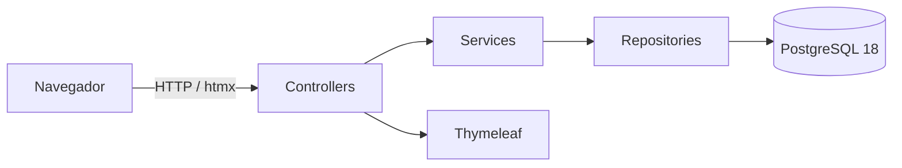

# HotelImpact — Guia de apresentação (aula de POO e demonstração do sistema)

> Material para apresentar o HotelImpact em sala de aula com foco em
> **Programação Orientada a Objetos**, preparado por leitura sistemática do
> código (out/2025). Toda classe, método, arquivo e comportamento citado
> existe no repositório; inferências estão marcadas como tais. Use a ordem
> dos capítulos como roteiro oral — cada seção cabe em 2–5 minutos de fala.

---

## Parte A — Roteiro de apresentação (11 tópicos)

1. Contextualização do problema e objetivo (§1)
2. Visão geral da arquitetura (§2)
3. Fundamentos de POO aplicados ao projeto (§3)
4. Classes, objetos e entidades (§4)
5. Encapsulamento, abstração, associação e composição (§5)
6. Interfaces, polimorfismo e herança (§6)
7. Camadas, injeção de dependência e separação de responsabilidades (§7)
8. Fluxos práticos de execução ponta a ponta (§8)
9. Persistência e integração com o banco (§9)
10. Testes, benefícios e limitações (§10)
11. Conclusão (§11)

Anexo: roteiro de demonstração ao vivo (§12) e perguntas prováveis do
professor com respostas (§13).

---

## 1. Contextualização do problema e objetivo

**Problema:** a operação de um hotel é uma máquina de estados — reservas,
estadias, contas, limpezas, manutenções — e pequenos hotéis resolvem isso
com cadernos, planilhas e a memória da recepção. O risco é operacional:
quarto reservado duas vezes, conta que fecha errada, quarto sujo vendido.

**Objetivo do HotelImpact:** um PMS (Property Management System) web que
centraliza essa operação e — este é o diferencial técnico a enfatizar —
**aplica as regras no servidor e reforça as críticas no banco de dados**,
não na interface.

**Público-alvo:** recepções de hotéis de pequeno/médio porte. Como projeto
acadêmico, demonstra engenharia de software aplicada a um domínio real.

*Fala sugerida:* "O HotelImpact não é um CRUD bonito: é um sistema em que as
regras são o produto — e onde a orientação a objetos organiza um domínio que
é essencialmente objetos do mundo real (hóspede, quarto, reserva) com
comportamento e regras."

## 2. Visão geral da arquitetura



- **Monolito em camadas** (MVC clássico do Spring): `controller → service →
  repository`; páginas renderizadas no servidor com **Thymeleaf**; navegação
  fluida com **htmx** (trocando apenas fragmentos HTML, sem rewrite para
  SPA em JavaScript).
- Dois públicos: **site institucional** público e **área administrativa**
  protegida por login (Spring Security + CSRF).
- Persistência com **Spring Data JPA/Hibernate** sobre **PostgreSQL 18**,
  esquema versionado por **Flyway**; testes de integração com
  **Testcontainers** (banco real efêmero); 200 testes automatizados e CI no
  GitHub Actions.

*Fala:* "A arquitetura é MVC em camadas — o padrão natural do Spring MVC —
com uma decisão de projeto importante: em vez de reescrever a interface como
uma SPA JavaScript, usamos htmx para ter a experiência fluida mantendo o
backend renderizando HTML."

## 3. Fundamentos de POO aplicados ao projeto

### 3.0 Matriz de decisão (análise antes da refatoração)

Levantamento sistemático do código existente (out/2025) — o que cada
conceito tem de evidência real, o que foi aproveitado, o que foi
implementado nesta refatoração e o que foi **deliberadamente descartado**:

| Conceito | Evidência já existente | Decisão | Justificativa |
|---|---|---|---|
| Has-A / Has-Many | 10+ `@ManyToOne` reais (`Reserva`→`Hospede`/`Quarto`; `Hospedagem`→`Reserva`/`Quarto`; `Consumo`/`Pagamento`→`Hospedagem`…) | aproveitar/documentar | relações são o domínio; lado N proprietário, sem coleções bidirecionais por decisão (evitar estado duplicado e N+1) |
| Sobrescrita `@Override` | `HxRedirectEntryPoint.commence()`, `CpfValidator.isValid()`, `HxUrlInterceptor.postHandle()`, `WebConfig.addInterceptors()`, 2× `ApplicationRunner.run()` | aproveitar | especializações reais de contratos do framework |
| Sobrecarga | `HospedagemService.checkOut(Long)` e `checkOut(Long, String)` | aproveitar | assinaturas com semântica distinta (com/sem justificativa de exceção) |
| Classe abstrata | `support/AbstractIntegrationTest` (superclasse abstrata de infraestrutura de teste) | aproveitar | compartilha o container PostgreSQL efêmero entre suítes |
| `final` | `Pagina` (classe final + construtor privado), campos `final` nas 11 views, campos injetados `final` (Lombok), `static final` nos services | **implementar: `final` nas classes `*View`** | views já são imutáveis por campos `final`; `final` na classe declara que projeções de leitura não devem ser especializadas |
| Classes abstratas JPA (`@MappedSuperclass` de `id`) | — | **descartado** | duplicação de `@Id` é idiomática e pequena; superclasse genérica adiciona acoplamento sem invariante de domínio |
| Interface nova | contratos existentes: `ConstraintValidator`, `HandlerInterceptor`, `WebMvcConfigurer`, `ApplicationRunner`, `JpaRepository` | **descartado criar novas** | nenhuma fronteira com 2+ implementações plausíveis; interface de implementação única é artificialismo |
| Polimorfismo de subtipos | dispatch de exceções no `GlobalExceptionHandler`; validador e entry point chamados pelos contratos | aproveitar + teste explícito | o chamador depende do contrato, não do concreto |
| Upcasting | implícito em todo uso de contrato (ex.: `SecurityConfig` registra o entry point como `AuthenticationEntryPoint`) | aproveitar + teste explícito | seguro e natural |
| Downcasting | **nenhum encontrado** (os `cast` do código são SQL/JPQL) | nada a eliminar | — |
| Herança entre entidades | — | **descartado** | o domínio não tem especialização de tipos; estados são enums + transições de serviço (BR-RES-008), não subclasses |
| `equals`/`hashCode`/`toString` em entidades | não existem | manter ausente | identidade JPA por `@Id`; métodos customizados trariam riscos de proxy/lazy |

Cada conceito: definição acessível → exemplo real do código → como é
aplicado → benefício/limitação → frase para uso oral.

### 3.1 Classes e objetos

- **Definição:** classe é o "molde"; objeto é a instância com estado próprio
  em memória (e, aqui, uma linha no banco).
- **Exemplo real:** `entity/Quarto.java` define o molde de todo quarto
  (número, categoria, andar, estado). O quarto **102** criado no seed é um
  objeto — instância com identidade própria (`id`) persistida na tabela
  `quarto`.
- **Como se vê no código:** `DataSeeder.quartoPorNumero("102")` carrega do
  banco um objeto `Quarto` gerenciado pelo Hibernate.
- **Benefício:** o mesmo molde descreve os 12 quartos da demonstração; o
  comportamento (§3.2) vale para todos.
- *Fala:* "Classe é a planta do quarto; objeto é cada quarto de verdade —
  com número próprio, estado próprio e uma linha no banco."

### 3.2 Atributos e métodos (estado + comportamento)

- **Definição:** atributos guardam estado; métodos expõem comportamento e
  invariantes.
- **Exemplo real com comportamento de domínio** (não só getters):
  - `entity/Reserva.java:123` — `getQuantidadeNoites()` calcula as noites do
    período semiaberto; `getValorBruto()` (linha 128) multiplica diária ×
    noites; `isAtiva()` (linha 133) encapsula o que significa "bloqueia o
    período" (PENDENTE ou CONFIRMADA).
  - `entity/Quarto.java:84` — `getCapacidadeEfetiva()` decide entre a
    capacidade operacional do quarto e a da categoria.
  - `entity/ItemCatalogo.java:82` — `isEstoqueBaixo()` concentra o critério
    do alerta do painel.
- **Benefício:** quem lê o service chama `reserva.getValorBruto()` sem
  re-implementar a fórmula — a regra vive **um único lugar**.
- *Fala:* "O comportamento está nas entidades: `getValorBruto()` é a
  fórmula da reserva escrita uma vez, usada por todos os fluxos."

### 3.3 Encapsulamento (com honestidade)

- **Definição:** esconder o estado interno atrás de métodos, protegendo
  invariantes.
- **O que existe:** todos os campos das entidades são `private`; o acesso
  ocorre por getters/setters (gerados por **Lombok** `@Getter/@Setter`);
  campos calculados (`valorBruto`, `capacidadeEfetiva`) não têm setter — são
  **derivados**, ninguém consegue gravar um valor bruto inconsistente.
- **Limitação declarada:** os setters das entidades são públicos — o projeto
  não protege as invariantes apenas na entidade: as invariantes **fortes**
  são garantidas nos **services transacionais** e no **banco**
  (CHECKs, EXCLUDE, índice parcial). Não afirmar que as entidades se
  auto-protegem sozinhas.
- **Benefício real:** estado impossível (estoque negativo, estados inválidos)
  é barrado em duas camadas: service + banco
  (`ck_item_catalogo_estoque_nao_negativo`).
- *Fala:* "Encapsulamos o que é derivado — ninguém seta valor bruto — e as
  invariantes críticas vivem nos services e nas constraints do banco,
  defesa em profundidade."

### 3.4 Abstração

- **Definição:** representar o essencial do negócio ignorando detalhes
  irrelevantes.
- **Exemplos reais:**
  - `Hospede` abstrai uma pessoa para os fins da operação (nome, contato,
    CPF — sem endereço, sem RG: o domínio não precisava).
  - `Reserva` abstrai o *contrato de intenção* (período + diária acordada),
    separado de `Hospedagem`, que abstrai a *estadia real*. Essa é a decisão
    de abstração mais importante do domínio.
  - `Pagamento` abstrai qualquer entrada de dinheiro como {valor, forma,
    estado} — o sistema não armazena dados de cartão.
- **Benefício:** cada conceito tem ciclo de vida, tela e regras próprias —
  cancelar uma reserva não afeta hospedagens passadas.
- *Fala:* "Separamos a intenção da execução: Reserva é o contrato,
  Hospedagem é a estadia — a mesma pessoa, conceitos diferentes."

### 3.5 Herança (existe, mas é pontual — não inventar hierarquias)

- **Definição:** uma classe especializa outra, herdando comportamento.
- **O que existe de verdade no código:**
  - `config/HxRedirectEntryPoint.java` — **herança com sobrescrita real**:
    `extends LoginUrlAuthenticationEntryPoint` e sobrescreve `commence()`
    com `@Override` para tratar sessão expirada na navegação htmx.
  - Hierarquia de exceções: `NegocioException` e
    `RegistroNaoEncontradoException` **ambas** `extends RuntimeException`
    (`exception/`).
  - Interfaces de repositório estendem `JpaRepository` (herança de contrato,
    implementação gerada pelo Spring Data — §6).
  - Nos testes: `support/AbstractIntegrationTest` é superclasse de
    infraestrutura (container PostgreSQL compartilhado).
- **O que NÃO existe:** não há hierarquia de entidades (ex.: `ReservaOnline
  extends Reserva`) — o domínio não precisou. **Dizer isso explicitamente é
  um ponto positivo**: herança é ferramenta, não requisito.
- *Fala:* "Herança é usada onde a especialização é real — o entry point de
  segurança herda e sobrescreve `commence()`; o domínio em si não precisou
  de hierarquias, e simular isso seria over-engineering."

### 3.6 Polimorfismo (com sobrescrita, não sobrecarga)

- **Definição:** o mesmo chamado se comporta conforme o tipo real do objeto.
- **Exemplos reais:**
  - **Sobrescrita (`@Override`):** `HxRedirectEntryPoint.commence()` — o
    Spring Security chama o método da superclasse; o objeto concreto decide
    se responde redirect HTTP ou header `HX-Redirect`.
  - **Polimorfismo de exceção:** `GlobalExceptionHandler` declara
    `@ExceptionHandler(NegocioException.class)` e
    `@ExceptionHandler(RegistroNaoEncontradoException.class)` — a JVM
    despacha para o handler do **tipo real** lançado.
  - **Via interface:** `CpfValidator implements ConstraintValidator<Cpf,
    String>` — o Bean Validation invoca `isValid()` sem conhecer a
    implementação (§6).
- **Cuidado ao apresentar:** sobrecarga de métodos (mesmo nome, assinaturas
  diferentes) **não é polimorfismo** — no projeto há sobrecarga apenas em
  `HospedagemService.checkOut(Long)` e `checkOut(Long, String)`; citar como
  conveniência de API, não como polimorfismo.
- *Fala:* "O polimorfismo aparece na prática: o handler de exceções
  despacha pelo tipo real, e o validador de CPF é chamado pela interface
  que o framework conhece."

### 3.7 Interfaces e contratos

- **Definição:** contrato que desacopla "o que" de "quem faz".
- **Exemplos reais:** `ConstraintValidator` (validação de CPF), `HandlerInterceptor`
  (`config/HxUrlInterceptor.java`), `WebMvcConfigurer` (`config/WebConfig.java`),
  `ApplicationRunner` (`DataSeeder`, `ConstraintsBancoRunner`) e os 10
  repositórios — **interfaces** cuja implementação o Spring Data gera em
  runtime (proxy).
- **Benefício:** trocar a implementação de um contrato não afeta quem
  consome; os testes fazem exatamente isso (`@MockitoBean` substitui a
  implementação real nos slices `@WebMvcTest`).
- *Fala:* "Todo ponto de extensão do Spring é uma interface: nosso validador
  de CPF, o interceptor de URLs e o seed são contratos que o framework
  chama sem conhecer os detalhes."

### 3.8 Associação e composição

- **Definição:** associação é "conhecer" (fraca); composição é "ser dono"
  (forte, o todo morre com as partes).
- **Exemplos reais (associação com persistência, via `@ManyToOne`):**
  `Reserva` → `Hospede` e `Quarto`; `Hospedagem` → `Reserva` e `Quarto`;
  `Consumo` → `Hospedagem` e `ItemCatalogo`; `Pagamento` → `Hospedagem`;
  `OrdemManutencao` → `Quarto`. Todas viram **FKs** no banco (ver
  `V1__esquema_base.sql`).
- **Composição conceitual:** `Hospedagem` *compõem-se de* consumos e
  pagamentos — a conta da hospedagem é a soma das **suas** partes, e as
  partes não existem sem a hospedagem (FK não anulável). Excluir a
  hospedagem faria os lançamentos órfãos — por isso a regra proíbe excluir
  hóspede/item com histórico (BR-HOS-003 em `docs/BUSINESS_RULES.md`).
- **Diferença de herança:** a `Hospedagem` não "é uma" `Reserva` — ela
  **referencia** a reserva; reuso por associação, não por hierarquia.
- *Fala:* "Consumo e pagamento são partes da conta da hospedagem —
  composição; a reserva referencia o hóspede — associação. Nada de
  herança entre entidades."

### 3.9 Enums e estados

- **Papel:** vocabulário fechado de estados — impossível gravar "canceladaa".
- **Exemplos reais (`enums/`):** `EstadoReserva` (PENDENTE, CONFIRMADA,
  CANCELADA, CONCLUIDA, NO_SHOW), `EstadoQuarto` (5 estados),
  `EstadoHospedagem`, `EstadoConsumo`, `EstadoPagamento`,
  `EstadoManutencao`, `PrioridadeManutencao`, `FormaPagamento`, `TipoItem`,
  `EstadoTarefaLimpeza` — 11 no total.
- **Persistidos** como `varchar` com **CHECK** no banco (defesa dupla);
  transições só por operações de service (máquinas de estado completas em
  `docs/BUSINESS_RULES.md`).
- *Fala:* "Estado no projeto é tipo, não texto livre: o enum delimita o
  que existe e o banco confere por CHECK."

### 3.10 Imutabilidade e invariantes

- **O que existe de imutável:** os **records** `RelatorioService.ResumoPeriodo`
  e `DashboardService.Indicadores` (Java `record` = imutável por
  construção — ideal para agregados de leitura); `Consumo.precoUnitario`
  congela o **preço histórico**; `Reserva.valorDiaria` idem.
- **Invariantes garantidas:** período semiaberto válido, estoque ≥ 0,
  uma hospedagem ativa por quarto (índice parcial), sem reservas ativas
  sobrepostas (EXCLUDE) — as duas últimas **no banco**, não em memória.
- **O que não existe:** entidades 100% imutáveis ou `BigDecimal` em
  value-objects dedicados — melhoria futura, não afirmar como feito.
- *Fala:* "Relatórios usam records imutáveis; e o preço é histórico — o
  lançamento congela o valor do dia."

## 4. Classes, objetos e entidades (aprofundamento para a banca)

- **Mapeamento objeto-relacional (JPA):** cada entidade anotada
  (`@Entity`, `@ManyToOne`, `@Version`) vira uma tabela; o
  Hibernate traduz objetos ↔ linhas. Ex.: `entity/Reserva.java` → tabela
  `reserva`.
- **Identidade:** `@Id` `@GeneratedValue` — o `id` é a identidade no banco;
  `@Version` (Reserva, Quarto, Hospedagem) dá **lock otimista** contra
  atualizações concorrentes.
- **Ciclo de vida:** transitório → gerenciado (persistent context) →
  destacado (DTO/view) — o app usa `open-in-view=false` e carrega
  relacionamentos com `JOIN FETCH` na hora certa (`findByIdComDetalhes`).
- *Fala:* "Cada entidade é uma tabela com comportamento; o id é a
  identidade e o @Version evita que duas recepções pisem no mesmo
  registro."

## 5. Encapsulamento, abstração, associação e composição (recap de fala)

Três frases de encadeamento para o slide único:
1. "O estado é privado; o que é derivado não tem setter" (encapsulamento).
2. "Reserva e Hospedagem separam intenção de execução" (abstração).
3. "A conta é composta de consumos e pagamentos; a reserva apenas referencia
   hóspede e quarto" (composição vs associação).

## 6. Interfaces, polimorfismo e herança (recap de fala)

- Herança onde é real (`HxRedirectEntryPoint` + exceções), polimorfismo por
  sobrescrita e por dispatch de exceção, contratos do Spring por toda a
  extensão. Se o professor perguntar "por que não há herança entre
  entidades?" — resposta pronta: *"porque o domínio não tem especialização
  de tipos; forjar hierarquia adicionaria complexidade sem regra de negócio."*

## 7. Camadas, injeção de dependência e SOLID

### 7.1 Responsabilidade de cada camada

| Camada | Responsabilidade | Evidência |
|---|---|---|
| Controller | HTTP: rotear, validar form, decidir view/redirect — **sem regra de negócio** | `controller/*Controller.java` (ex.: `ReservaController`) |
| Service | casos de uso + regras + transações | `service/*Service.java` (`ReservaService.criar`) |
| Repository | acesso a dados declarativo | `repository/*Repository.java` |
| DTO/Form | fronteira de entrada validada (Bean Validation) | `dto/*Form.java` |
| DTO/View | projeção de saída para a tela | `dto/*View.java` + conversores `View.de(...)` |
| View (Thymeleaf) | apresentação; lógica só de exibição | `templates/**` |

### 7.2 Injeção de dependência e IoC

- Todos os services/controllers recebem colaboradores **por construtor**
  (Lombok `@RequiredArgsConstructor`); o Spring (container IoC) monta o
  grafo em runtime. Ex.: `HospedagemService` recebe `reservas`,
  `hospedagens`, `quartos`, `pagamentoService` — nunca os constrói.
- Benefício: testes substituem qualquer colaborador por mock
  (`@MockitoBean`) sem tocar no código de produção.

### 7.3 SOLID com evidências (honesto)

| Princípio | Status no projeto | Evidência |
|---|---|---|
| **S**RP | **claramente demonstrável** | cada service tem um motivo único de mudança: `ReservaService` só reserva; `PagamentoService` só conta/dinheiro |
| **O**CP | parcial | novos handlers de exceção/estados se adicionam sem alterar os existentes; adicionar nova forma de pagamento muda o enum (não é aberto por abstração) |
| **L**SP | parcial | `HxRedirectEntryPoint` é substituível pelo tipo base; sem outros exemplos amplos |
| **I**SP | parcial | as interfaces usadas são pequenas e focadas (`HandlerInterceptor`), mas a maioria vem do framework |
| **D**IP | **claramente demonstrável** | services dependem de interfaces de repositório; `PagamentoService` é injetado no `HospedagemService` — dependem de abstrações, não de implementações concretas |

### 7.4 Padrões de projeto (implementados vs mecanismos do framework)

- **Implementados por nós:** Service Layer; Repository (uso do padrão);
  DTO/ViewModel; PRG (Redirect After POST); tratamento centralizado de
  exceções (`@ControllerAdvice`); validador customizado (Strategy via
  `ConstraintValidator`); seed idempotente.
- **Fornecidos pelo framework (usar com atribuição correta):** Proxy dos
  repositórios (Spring Data gera a implementação); hooks do Spring
  (ex.: `WebMvcConfigurer`); IoC container; ORM (Hibernate);
  Front Controller (DispatcherServlet do Spring MVC).
- *Fala honesta:* "Não digo que implementamos um ORM ou um container IoC —
  usamos; o que implementamos de padrão é a camada de serviços, os DTOs,
  o PRG e o validador."

## 8. Fluxos práticos de execução (ponta a ponta, reais)

### 8.1 Criação/edição de um quarto (`QuartoController` + `QuartoService`)

```text
Interface (/quartos/novo) → POST /quartos → QuartoController.criar
  → @Valid QuartoForm (Bean Validation: @NotBlank numero, categoria obrigatória)
  → BindingResult: se inválido, re-render do formulário com erros inline
  → QuartoService.criar/salvar: numero único (existsByNumero), categoria ativa
  → Quarto (entidade) → QuartoRepository.save → Hibernate INSERT → PostgreSQL
  → redirect:/quartos (PRG) → flash de sucesso → Thymeleaf renderiza a lista
  → com htmx (HX-Request), apenas o fragmento "conteudo" troca na SPA
```
- **Onde aparece POO:** o form é um objeto de fronteira; a entidade carrega
  a invariante derivada (`getCapacidadeEfetiva`); a associação com
  `CategoriaQuarto` vira FK; a transação `@Transactional` garante tudo-ou-nada.

### 8.2 Criação e confirmação de uma reserva (`ReservaService`)

```text
Interface (/reservas/novo) → POST /reservas → ReservaController.criar
  → @Valid ReservaForm (datas ISO, hóspedes 1-20, diária @DecimalMin)
  → ReservaService.criar: validarPeriodo → exigirQuartoReservavel
    → validarCapacidade (Quarto.getCapacidadeEfetiva) → exigirPeriodoLivre
    → validarExcecaoDeDataPassada → validarDesconto
  → new Reserva(); gerarCodigo(); valorTotal = getValorBruto() - desconto
  → ReservaRepository.save → INSERT (EXCLUDE do banco impede sobreposição!)
  → redirect:/reservas/{id} (PENDENTE) → POST /{id}/confirmar → CONFIRMADA
```
- **Onde aparece POO:** comportamento da entidade (`getValorBruto`,
  `isAtiva`); associação reserva→hóspede/quarto; enum `EstadoReserva`;
  invariante de sobreposição reforçada no banco (`ex_reserva_quarto_periodo`).

### 8.3 Pagamento e operação de hospedagem (`HospedagemService` + `PagamentoService`)

```text
Tela da hospedagem → POST /hospedagens/{id}/pagamentos
  → @Valid PagamentoForm (valor @DecimalMin("0.01"), forma @NotNull)
  → PagamentoService.registrar: hospedagem != CANCELADA
  → Pagamento CONFIRMADO (dataHora = now) → INSERT
  → a tela recalcula saldoDevedor = totalConta - confirmados (na leitura)
  → POST /{id}/check-out: saldo > 0 exige motivo → CANCELADA; senão ENCERRADA
  → reserva → CONCLUIDA; quarto → LIMPEZA (mesma transação @Transactional)
```
- **Onde aparece POO:** composição hospedagem↔pagamentos; enum de estado;
  invariante "1 hospedagem ativa por quarto" garantida por **índice
  parcial** do banco; polimorfismo no tratamento de exceções por tipo.

## 9. Persistência e integração com o banco (resumo didático)

- **JPA/Hibernate:** objetos ↔ tabelas; `@ManyToOne` = FK; `@Version` =
  lock otimista; `open-in-view=false` força carregamento explícito
  (`JOIN FETCH`).
- **Spring Data JPA:** escrevemos apenas interfaces; queries derivadas
  (`findByNumero`) ou `@Query` JPQL (`HospedeRepository.buscarPorTermo`) —
  SQL parametrizado, sem injeção.
- **Transações:** `@Transactional` por caso de uso no service — o check-out
  (hospedagem + reserva + quarto) é atômico.
- **PostgreSQL + Flyway:** schema versionado na `V1`; **constraints são o
  trunfo do projeto** (EXCLUDE de período, índice parcial, CHECKs de
  estado/estoque) — ver `ARCHITECTURE.md` §5.1.
- **Validação em dois níveis:** form (Bean Validation — formato/presença,
  `dto/*Form`) vs domínio (service — regras que dependem do estado do
  mundo, ex.: período conflitante). Não confundir: `@DecimalMin` valida
  formato; `exigirPeriodoLivre` valida negócio.
- **Thymeleaf + htmx + JS:** o servidor renderiza HTML completo ou
  fragmento (`controller/Pagina.renderizar`); `static/js/app.js` (delegação
  de eventos) e `htmx.min.js` (vendorizado) fazem a troca parcial — sem
  framework frontend.

## 10. Testes, benefícios e limitações

- **200 testes, 4 níveis:** validação de forms (unitário), slice por tela
  (`@WebMvcTest` com `@MockitoBean`), integração com PostgreSQL real
  efêmero (**Testcontainers**, ex.: `ReservasIntegracaoTest`), seed
  (`DataSeederTest`: idempotência/integridade) e migração
  (`MigracaoFlywayTest`). CI no GitHub Actions roda tudo a cada push.
- **Como os testes verificam POO/regras:** cada método de teste cita a
  regra (ex.: `reservaSobrepostaEBloqueadaMasPeriodoAdjacenteEAceito`) e
  exerce objetos reais contra o banco real.
- **Benefícios da POO aqui:** um domínio legível (as entidades são o
  glossário do hotel), regras em um só lugar, troca de implementação por
  interface, testabilidade por injeção.
- **Limitações (apresentar antes que perguntem — ver
  `IMPLEMENTATION_GAPS.md`):** entidade `TarefaLimpeza` sem UI; sem edição
  de reserva; categoria sem desativação; um único usuário (sem auditoria de
  quem fez); Boot 4.2.0-M2; deploy não executado.

## 11. Conclusão (fala de encerramento)

> "O HotelImpact mostra a POO fazendo o que ela promete: o domínio vira
> vocabulário (Hospede, Quarto, Reserva, Hospedagem), o comportamento fica
> junto do estado (getValorBruto, getCapacidadeEfetiva), as invariantes
> fortes descem até o banco (EXCLUDE, índice parcial, CHECK) e a arquitetura
> em camadas com injeção de dependência mantém tudo testável — 200 testes
> provam. Herança é pontual porque o domínio é plano — e saber **não usar**
> um conceito também é orientação a objetos."

---

## 12. Roteiro de demonstração ao vivo (15–20 min)

| Passo | Tela/arquivo abrir | O que dizer |
|---|---|---|
| 1 | `/` (landing) | identidade; "Entrar" |
| 2 | `/login` → `/painel` | credenciais dev; painel = abertura do dia |
| 3 | `entity/Quarto.java` no editor | classe, atributos, `getCapacidadeEfetiva` |
| 4 | `entity/Reserva.java` | `getValorBruto`, `isAtiva` (comportamento) |
| 5 | `/reservas/novo` no navegador | sugerir diária; tentar período ocupado → regra nega |
| 6 | `service/ReservaService.java:criar` | as validações em sequência |
| 7 | `V1__esquema_base.sql` (EXCLUDE) | "a mesma regra, no banco" |
| 8 | fluxo completo na UI | confirmar → check-in → consumo → pagamento → check-out → limpeza |
| 9 | `validation/CpfValidator.java` | interface + polimorfismo |
| 10 | `docs/BUSINESS_RULES.md` | matriz de rastreabilidade; 34 regras |

Demonstráveis rápidos: sidebar recolhível; voltar/avançar na SPA; tema
claro/escuro; busca de hóspedes (um campo, quatro critérios).

## 13. Perguntas prováveis do professor — respostas prontas

1. **Qual é a diferença entre classe e objeto?** Classe é o molde
   (`Quarto.java`); objeto é a instância com identidade (quarto 102, `id`,
   linha no banco). Na prática, o Hibernate sincroniza os dois.
2. **Por que `QuartoForm` não é a entidade `Quarto`?** O form é um DTO de
   fronteira: existe para **validar entrada** (Bean Validation, strings do
   request) e morre na requisição; a entidade carrega identidade,
   relacionamentos e comportamento. Misturá-los acoplaria HTTP ao domínio
   (e permitiria o cliente setar campos internos).
3. **Por que separar Controller e Service?** Controller é tradução
   HTTP→caso de uso (thin); service concentra a regra e a transação —
   reutilizável por qualquer futuro canal (ex.: API REST) e testável sem
   web. Evidência: `ReservasWebTest` testa o controller com service mockado;
   `ReservasIntegracaoTest` testa o service com banco real.
4. **Onde há encapsulamento?** Campos privados; valores derivados sem
   setter (`getValorBruto`); e — o ponto forte — invariantes reforçadas no
   banco (CHECK/EXCLUDE). Limitação honesta: setters públicos das entidades
   existem; a proteção forte está nos services.
5. **O sistema usa herança e polimorfismo? Evidências?** Herança:
   `HxRedirectEntryPoint extends LoginUrlAuthenticationEntryPoint`
   (sobrescreve `commence()` com `@Override`) e as exceções
   `extends RuntimeException`. Polimorfismo: dispatch dos handlers de
   exceção por tipo real; validador chamado pela interface
   `ConstraintValidator`. Entre entidades: não há — por decisão de domínio.
6. **Associação vs composição?** Reserva→Hóspede é associação (a reserva
   referencia); Consumo/Pagamento→Hospedagem são partes da conta
   (composição conceitual, FK não anulável). Reuso por composição, não por
   herança.
7. **Por que interfaces e injeção de dependência?** Trocabilidade para
   testes (`@MockitoBean`), acoplamento ao contrato (DIP) e integração com
   o framework por pontos de extensão (`ApplicationRunner`,
   `HandlerInterceptor`).
8. **Papel do JPA e do Hibernate?** JPA é a especificação (anotações,
   contrato de persistência); Hibernate é a implementação (ORM: gera SQL,
   cache de primeiro nível, lock otimista via `@Version`). Spring Data JPA
   adiciona o padrão Repository (proxies de interfaces).
9. **Como o sistema impede operações inválidas?** Três camadas: validação
   de formato no form; regra de negócio no service
   (`NegocioException` → mensagem ao operador); invariante no banco
   (EXCLUDE/índice parcial/CHECK — sobrevive até a concorrência extrema).
10. **Como os testes verificam as regras?** Integração contra PostgreSQL
    real (Testcontainers) exercita as próprias constraints; os nomes dos
    testes citam a regra (`checkOutComSaldoPendenteSemMotivoEBloqueadoSemAlterarEstado`).
11. **O que melhoraria arquiteturalmente?** Migrar Boot para GA; desligar
    `ddl-auto=update` após validação em produção; gestão de usuários com
    auditoria; edição de reserva; UI para `TarefaLimpeza`
    (`IMPLEMENTATION_GAPS.md` tem a lista completa com gravidades).
12. **Por que htmx e não React?** Experiência SPA sem reescrever 19 telas
    nem criar API REST duplicada; backend continua renderizando HTML
    (fragmentos `th:fragment="conteudo"`), URLs/histórico preservados via
    `HX-Push-Url`; 50KB vendorizados, zero acoplamento frontend/backend.
13. **SOLID está todo presente?** SRP e DIP claramente; OCP/LSP/ISP
    parcialmente — a tabela do §7.3 é a resposta honesta.

---

## Anexo — Referências rápidas para a aula

- Regras de negócio completas: `docs/BUSINESS_RULES.md` (34 regras BR-XXX).
- Modelo de dados e constraints: `docs/ARCHITECTURE.md` §5.
- Lacunas e riscos: `docs/IMPLEMENTATION_GAPS.md`.
- Máquinas de estado (Mermaid): `docs/BUSINESS_RULES.md`.
